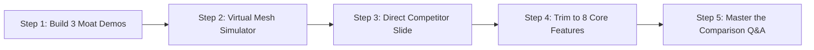

# RakshaNet (SignalRescue AI): Verified Competitor and Uniqueness Report

> **Strategic Pitch Positioning:**  
> *"Existing mesh apps solve how people communicate when the network fails. RakshaNet solves how rescue agencies decide where to go first when the network fails."*

---

## Table of Contents

- [1. Executive Bottom Line](#1-executive-bottom-line)
- [2. Verified Corrections & Reality Check](#2-verified-corrections--reality-check)
- [3. Competitor Deep Dives (Verified)](#3-competitor-deep-dives-verified)
  - [Crisis Connect (Primary Rival)](#crisis-connect)
  - [Tremour (Hackathon PoC)](#tremour)
  - [Sahayata Setu (Civilians & Volunteers)](#sahayata-setu)
  - [General Mesh Messengers (Bridgefy, BitChat, Briar)](#general-mesh-messengers)
- [4. Definitive Feature Matrix & Differentiation](#4-definitive-feature-matrix--differentiation)
  - [A. Already Shipped by Competitors (Do Not Claim as Unique)](#a-already-exists-do-not-claim-as-unique)
  - [B. Partially Exists (Claim Only RakshaNet's Specific Twist)](#b-partially-exists-claim-only-your-specific-twist)
  - [C. True Candidate Differentiators (Uncontested Territory)](#c-not-found-in-any-product-checked-your-candidate-differentiators)
- [5. Where Competitors Lead Today](#5-where-competitors-beat-you-today)
- [6. Defensible Pitch Positioning & Claims to Avoid](#6-why-rakshanet-is-different)
- [7. Pre-Pitch Action Items & Demo Strategy](#7-what-to-do-before-the-pitch)

---

## 1. Executive Bottom Line

Direct source verification against public repositories (READMEs, codebases, commits) of **Crisis Connect**, **Sahayata Setu**, **Tremour**, **Bridgefy**, and the broader offline mesh ecosystem establishes the following ground truths:

1. **What Cannot Be Claimed as Unique:**  
   You cannot claim that *Bluetooth/BLE mesh*, *One-tap SOS*, *offline vector maps*, *store-and-forward delay-tolerant networking*, *on-device AI*, or *cryptographic message signing* is unique. Existing open-source and commercial products already ship these capabilities.
2. **Where the Real Moat Lies:**  
   RakshaNet's true, defensible advantage is the **Intelligence & Decision-Support Layer** built *on top* of the raw mesh data stream. None of the audited products possess:
   - Automated spatial incident clustering (DBSCAN).
   - Telemetry-derived communication-gap ("black hole") detection.
   - Probabilistic isochrone search zones.
   - Critical infrastructure and cascading failure modeling.
   - Algorithmic rescue resource optimization and dispatch suggestions.
3. **Execution Caution:**  
   Competitors have shipped production code (e.g., Crisis Connect is live on Google Play & Apple App Store with ~300k lines of code and 600+ tests). RakshaNet's analytical features are currently specification-grade. **"Unique" only counts in front of hackathon judges and investors if it can be demonstrated live.**

---

## 2. Verified Corrections & Reality Check

Auditing the actual source trees and manifests reveals critical discrepancies from generic comparison tables:

| Claim in Initial Drafts | What Source Repositories Actually Prove |
|---|---|
| *Sahayata Setu has no offline maps* | **False:** Sahayata Setu bundles offline maps via MapLibre and OpenStreetMap tiles. |
| *Tremour has offline maps* | **False:** None listed. Its dashboard only binds to a local LAN. |
| *Tremour has offline AI as a core strength* | **False:** Its triage is a rudimentary regex/keyword rule list. Gemma integration is an empty stub; README explicitly notes *"Keyword rules, not a real LLM"*. |
| *Crisis Connect has missing-person search features* | **Unverified:** No spatial search envelopes or algorithms documented; it only supports rescuer sighting logs and raw message feeds. |
| *Crisis Connect Wi-Fi Direct status* | **Accurate:** Wi-Fi Direct remains on their public development roadmap. |
| *Digital Twin & Device-to-Disaster Intelligence are separate features* | **Terminology bloat:** These are branding synonyms for the spatial data pipeline. Drop them to keep the pitch focused and credible. |

---

## 3. Competitor Profiles (Verified)

### Crisis Connect
*The strongest direct competitor in the disaster mesh space.*
- **Maturity & Deployment:** Live production application on both Google Play Store and Apple App Store (~300,000 LOC, 611 automated tests, 19 supported languages including Hindi).
- **Networking & Cryptography:** BLE GATT mesh relay with hop TTL and duplicate message cache. Shipped end-to-end encryption (offline AES-256-GCM; online Signal Protocol ratchet).
- **Media Support:** Offline peer-to-peer voice calls, images, and binary file transfers.
- **AI & Assistance:** Real on-device local LLM assistant powered by LiteRT-LM (TensorFlow Lite runtime).
- **Agency Layer:** Role-based access control with offline-verifiable X.509 rescue certificates, agency broadcast channels, and a basic web dispatch viewer.
- **Critical Architectural Gap:** Its agency dashboard merely acts as a centralized message inbox. It lacks multi-signal clustering, communication blackout anomaly detection, search envelope generation, or CAP/CAD automated export.

### Tremour
*A hackathon proof-of-concept repository (2 commits, minimal community adoption).*
- **Transports:** Google Nearby Connections, Wi-Fi Direct, and BLE.
- **Networking:** Ed25519 cryptographic signing (no payload confidentiality encryption), priority queues, message TTL, and store-and-forward caching.
- **Agency Ingestion:** Features a mock Common Alerting Protocol (CAP) gateway injecting official state alerts into the mesh.
- **Key Takeaway:** Authority-to-mesh broadcast already exists in Tremour—do not claim authority broadcasts as RakshaNet's invention.

### Sahayata Setu
*A Flutter-based community relief application.*
- **Transports & Security:** BLE and Wi-Fi mesh utilizing modern cryptographic primitives (Ed25519 signing, X25519 key exchange, AES-GCM encryption).
- **Civilian Capabilities:** Help distress requests, public announcements, missing-person boards with photo attachments, volunteer tasking, and offline MapLibre tiles.
- **Key Takeaway:** Zero cloud ingestion pipeline and no agency command dashboard. Focused on grassroots volunteer coordination.

### General Mesh Messengers
*(Bridgefy, BitChat, Briar, Meshtastic)*
- General-purpose peer-to-peer offline chat applications over Bluetooth or LoRa.
- Completely lack disaster incident schemas, priority triage, civilian-to-agency pipelines, and spatial rescue analytics.

---

## 4. Definitive Feature Matrix & Differentiation

### A. Already Exists (Do NOT Claim as Unique)

| Capability | Prior Art & Existing Implementations |
|---|---|
| **One-Tap SOS Button** | Crisis Connect (with countdown widgets), Tremour |
| **Offline-First Mode & BLE Discovery** | All audited products (Crisis Connect, Sahayata Setu, Tremour, Bridgefy) |
| **Wi-Fi Peer-to-Peer Transport** | Tremour (shipped); Sahayata Setu (shipped); Crisis Connect (roadmap) |
| **Multi-Hop Store-and-Forward Mesh** | Crisis Connect, Tremour, Bridgefy, Briar |
| **Message Deduplication & TTL Limits** | Crisis Connect, Tremour |
| **Offline Peer Chat** | All competitors |
| **Bundled Offline Vector Maps** | Crisis Connect, Sahayata Setu (MapLibre + OSM) |
| **On-Device AI / LLM Assistant** | Crisis Connect (LiteRT-LM), Tremour (regex) |
| **Emergency Text Triage** | Tremour (regex), Crisis Connect (LLM) |
| **Adaptive Battery Management** | Tremour, Crisis Connect |
| **Cryptographic Signing & Encryption** | Crisis Connect (Signal/AES-GCM), Sahayata Setu (X25519/AES), Tremour (Ed25519) |
| **Government Broadcast to Mesh** | Tremour (CAP gateway), Crisis Connect (Agency Bridge) |
| **Basic Web Command Dashboard** | Crisis Connect, Tremour |

---

### B. Partially Exists (Claim Only Your Specific Twist)

| Capability | What Competitors Have | RakshaNet's Distinctive Twist |
|---|---|---|
| **Position Classification** | Share raw coordinate strings | Explicit three-state schema: `LIVE_GPS` vs. `LAST_KNOWN` vs. `ESTIMATED_ZONE` with uncertainty radii |
| **Presence History** | Sighting feeds & raw check-ins | Hop-by-hop breadcrumb vector timeline per device for search teams |
| **Family Circles** | General contact pairing | Passive ambient mesh detection of family IDs during zero-net blackout |
| **Safety Signals** | Generic text status messages | Cryptographic *"I AM SAFE"* beacon that automatically deprecates prior pending SOS tickets |
| **SOS Status Feedback** | Simple delivery checkmarks | End-to-end 6-stage delivery state machine through to agency CAD ingestion |
| **Hazard GIS Mapping** | Isolated weather/disaster feeds | Dynamic multi-layer overlay correlating live SOS pins with flood contours and bridge outages |
| **Agency Integration** | Inbound mock CAP alerts (Tremour) | Outbound CAP/CAD emergency tickets with full mesh relay provenance |
| **Shelter Intelligence** | Static text message lists | Bidirectional shelter capacity synchronization back down the mesh |

---

### C. Not Found in Any Product Checked (Your Candidate Differentiators)

These 9 capabilities represent RakshaNet's true proprietary moat:

1. **DBSCAN Spatial Incident Clustering:** Merging 30 redundant phone beacons from the same apartment into a single actionable incident record with device count estimates.
2. **Communication-Gap ("Black Hole") Detection:** Identifying severe anomaly dropouts in heartbeat density ($500 \to 150 \to 20$ nodes) to dispatch reconnaissance drones to silent zones.
3. **Probabilistic Search Zones:** Isochrone search envelopes generated from last known fix, elapsed time drift, and flood current vectors.
4. **RSSI Proximity Trilateration:** Estimating civilian envelopes when GPS is completely unavailable using neighboring anchor fixes.
5. **$\text{Devices} \neq \text{People}$ Population Modeling:** Statistical inference converting RF device telemetry into realistic survivor counts.
6. **Critical Infrastructure Single-Point-of-Failure Monitoring:** Real-time risk modeling on bridges, substations, and access corridors.
7. **Cascading Disaster Dependency Modeling:** Anticipating secondary infrastructure collapses ($Rain \to Flood \to Bridge \to Route Blocked$).
8. **Algorithmic Resource Dispatch Optimization:** Matching boat, 4WD, and ambulance fleets against triage urgency and terrain constraints.
9. **The Complete Closed Loop:** Unbroken data continuum from offline handset $\to$ DTN mesh $\to$ Cloud AI $\to$ Web Command Center $\to$ Rescue Teams.

---

## 5. Where Competitors Beat You Today

Being honest about current technical trade-offs builds immense credibility with judges and technical evaluators:

| Vector | Competitor Advantage | RakshaNet Current State | Action Plan |
|---|---|---|---|
| **Encryption** | Crisis Connect & Sahayata Setu ship live end-to-end encryption (AES-256-GCM / Signal Protocol). | Specification design. | Implement Libsodium / TweetNaCl primitives for prototype. |
| **Platform Scope** | Crisis Connect ships cross-platform (Android & iOS). | Android-first React Native architecture. | Maintain Android-first focus for BLE background scanning advantages. |
| **Production Maturity** | Crisis Connect has 300k lines of code, 611 tests, and active store listings. | Hackathon prototype / architecture. | Focus on polished, working end-to-end demo rather than raw codebase size. |
| **Rich Media** | Crisis Connect supports offline voice calls and photo transfers over mesh. | Lightweight text, telemetry, and structured SOS packets only. | Position text/telemetry as a deliberate bandwidth optimization for disaster mesh stability. |
| **Rescuer Trust** | Crisis Connect features cryptographically signed responder certificates. | Open mesh model vulnerable to spoofing. | Adopt agency-signed QR certificates on roadmap. |
| **On-Device LLM** | Crisis Connect runs a real on-device model via LiteRT-LM. | On-device SLM design. | Demo honest, blazing-fast regex/ONNX triage rules rather than unverified LLM claims. |

---

## 6. Why RakshaNet is Different

### The Winning Narrative
> *"Existing mesh apps ask: **'How do people talk when cell towers go dark?'**  
> RakshaNet asks: **'How do rescue commanders decide where to deploy limited boats and helicopters first when communications go dark?'**"*

### Defensible Pitch Claims
- ✅ *"Mesh messengers route conversations. RakshaNet transforms noisy, decentralized distress pings into structured incidents, probabilistic search zones, and optimized dispatch plans."*
- ✅ *"We don't just detect who is broadcasting—we detect who has abruptly gone silent."*
- ✅ *"Architected specifically for Indian disaster management: Native Common Alerting Protocol (CAP) ingestion, NDRF/SDRF operational vocabulary, and low-resource Hindi/Marathi localization."*

### Claims to Avoid (Judges Will Disprove These Instantly)
- ❌ *"The first offline disaster communication app"* (False: Bridgefy, Crisis Connect, Sahayata Setu exist).
- ❌ *"The first mesh emergency SOS platform"* (False: Crisis Connect and Tremour exist).
- ❌ *"Proprietary breakthrough in offline AI"* (False: Crisis Connect runs on-device LiteRT-LM).
- ❌ *"First encrypted disaster mesh"* (False: Sahayata Setu and Crisis Connect already ship this).

---

## 7. What to Do Before the Pitch

1. **Build and Demo at Least Three Core Differentiators:**  
   Focus 80% of development effort on working demos of:
   - Live DBSCAN incident clustering on the command dashboard.
   - Dynamic communication-gap ("black hole") visualization.
   - Probabilistic search zone rendering from a stale location pin.
2. **Build a 100–200 Node Virtual Mesh Simulator:**  
   You cannot realistically gather 50 phones in a presentation hall. Build a script (`simulate_mesh.py`) that feeds 150 simulated peer hops and SOS beacons into the dashboard to demonstrate clustering and comm-gap detection in real time.
3. **Include a Transparent Competitor Slide:**  
   Explicitly name **Crisis Connect**. Showing a matrix that acknowledges their production maturity while highlighting your intelligence layer commands deep respect from senior engineering judges.
4. **Focus the Pitch on 8 Core Features:**  
   Do not overwhelm the audience with all 34 features. Pitch the **Core 8**:
   - One-Tap SOS with Location States
   - Store-and-Forward Mesh
   - Lightweight Edge Triage
   - Opportunistic Cloud Sync
   - DBSCAN Incident Clustering
   - Comm-Gap Black Hole Detection
   - Probabilistic Search Zones
   - Command Center & Dispatch Optimization
5. **Master the Inevitable Comparison Question:**  
   - *Question:* *"Crisis Connect already has a web dashboard and rescue operations. How are you different?"*
   - *Answer:* *"Crisis Connect provides an administrative message inbox for responders to read individual survivor chats. RakshaNet is an operational spatial intelligence engine: it ingests thousands of chaotic beacons, clusters them into unified incidents, flags blackout sectors where phones abruptly stopped communicating, and generates optimized boat dispatch plans."*
