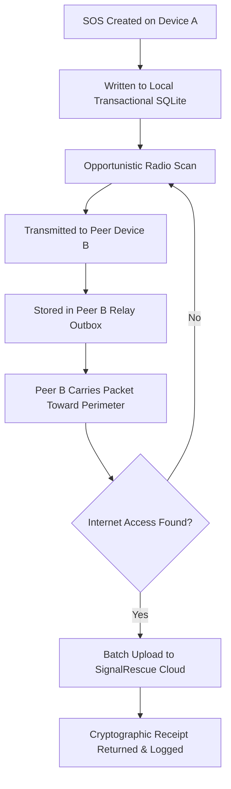
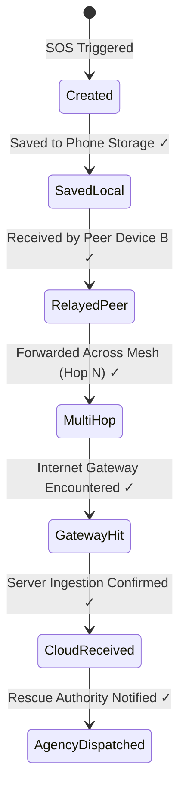
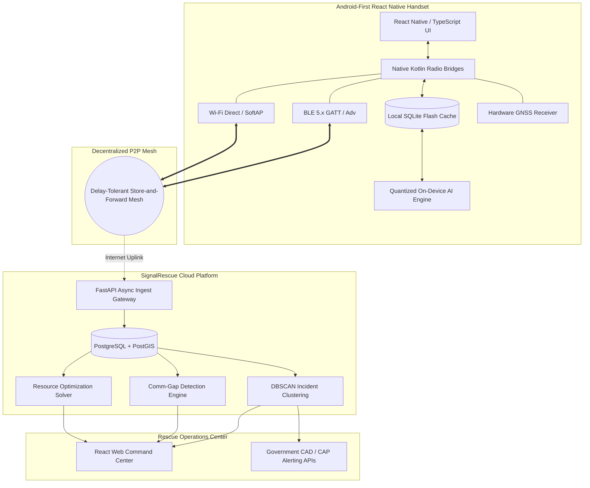

# SignalRescue AI (RakshaNet) — Complete Feature Set

> **Executive Overview:**  
> SignalRescue AI is an **offline-first disaster communication, localization, and rescue-intelligence platform**. Its mission is to keep survivors connected during catastrophic events when cellular towers and Internet infrastructure fail, and automatically translate collected opportunistic telemetry into actionable intelligence for rescue authorities upon Internet recovery.

---

## 📑 Feature Taxonomy & Table of Contents

### I. Core Offline Communication & Mesh Protocol
- [01. 🚨 One-Tap SOS](#01--one-tap-sos)
- [02. 📱 Completely Offline Emergency Mode](#02--completely-offline-emergency-mode)
- [03. 🔵 Bluetooth (BLE) Device Discovery & Signaling](#03--bluetooth-ble-device-discovery--signaling)
- [04. 📶 Wi-Fi Peer-to-Peer (Wi-Fi Direct) Data Transport](#04--wi-fi-peer-to-peer-wi-fi-direct-data-transport)
- [05. 🔄 Multi-Hop Mesh Relay](#05--multi-hop-mesh-relay)
- [06. 💬 Zero-Infrastructure Offline Chat](#06--zero-infrastructure-offline-chat)
- [10. 📦 Store-and-Forward Delay-Tolerant Networking](#10--store-and-forward-delay-tolerant-networking)
- [11. 🔐 Message Deduplication & Hash Verification](#11--message-deduplication--hash-verification)
- [12. ⏳ Message Time-To-Live (TTL) & Hop Limits](#12--message-time-to-live-ttl--hop-limits)

### II. Offline Localization & Geospatial Mapping
- [07. 📍 Offline GPS & Hardware Location Cache](#07--offline-gps--hardware-location-cache)
- [08. 🗺️ Bundled Offline Vector Maps](#08--bundled-offline-vector-maps)
- [09. 🧭 GPS-Independent Proximity Location Estimation](#09--gps-independent-proximity-location-estimation)
- [17. 👤 Last-Known Presence Timeline](#17--last-known-presence-timeline)
- [18. 🔎 Missing-Person Probabilistic Search Zone](#18--missing-person-probabilistic-search-zone)

### III. On-Device & Cloud AI Intelligence
- [13. 📴 Lightweight On-Device AI Assistant (SLM)](#13--lightweight-on-device-ai-assistant-slm)
- [14. 🧠 Automated AI Emergency Classification](#14--automated-ai-emergency-classification)
- [15. 📊 Spatial Incident Clustering (DBSCAN)](#15--spatial-incident-clustering-dbscan)
- [16. 📡 Communication-Gap & Black Hole Anomaly Detection](#16--communication-gap--black-hole-anomaly-detection)
- [19. 👥 Affected Population & Device Estimation](#19--affected-population--device-estimation)
- [21. 🚧 Critical Infrastructure Vulnerability Monitoring](#21--critical-infrastructure-vulnerability-monitoring)
- [22. 🔗 Cascading Disaster Dependency Analysis](#22--cascading-disaster-dependency-analysis)

### IV. Rescue Coordination & Operational Command
- [20. 🌊 Real-Time Disaster Risk & Hazard Overlays](#20--real-time-disaster-risk--hazard-overlays)
- [23. 🚑 Algorithmic Rescue Resource Optimization](#23--algorithmic-rescue-resource-optimization)
- [24. 🗺️ Unified Government & Agency Command Dashboard](#24--unified-government--agency-command-dashboard)
- [25. 🔔 Automated Government Dispatch & CAD Ingestion](#25--automated-government-dispatch--cad-ingestion)
- [26. 📲 End-to-End Emergency Status Tracking](#26--end-to-end-emergency-status-tracking)

### V. Resilience, Civilian Modes & System Hardening
- [27. 🔋 Adaptive Battery-Aware Mesh Governance](#27--adaptive-battery-aware-mesh-governance)
- [28. 🔒 Cryptographic Security, Privacy & Integrity](#28--cryptographic-security-privacy--integrity)
- [29. 👨‍👩‍👧 Family & Group Emergency Network](#29--family--group-emergency-network)
- [30. 🟢 One-Tap Safety Check-In ("I AM SAFE")](#30--one-tap-safety-check-in-i-am-safe)
- [31. 🏠 Dynamic Shelter Capacity Intelligence](#31--dynamic-shelter-capacity-intelligence)
- [32. 📢 Authoritative Emergency Mesh Broadcast](#32--authoritative-emergency-mesh-broadcast)

### VI. System Architecture & Distinct Value
- [33. 🧑‍💻 Technical Architecture & Data Pipeline](#33--technical-architecture--data-pipeline)
- [34. 🏆 Core Innovation: The Complete Vision](#34--core-innovation-the-complete-vision)

---

## 1. 🚨 One-Tap SOS

The cornerstone user interaction is an immediate, prominent **Emergency SOS Button**:

- **Tactile Activation:** Press and hold for 1.5 seconds with haptic feedback to prevent accidental triggers (with accessible double-tap confirmation fallback for accessibility tools).
- **Deterministic Payload Generation:** Instantly compiles all available environmental and system telemetry:
  - Emergency UUID and cryptographic signature
  - Ephemeral device pseudonym (e.g. `SR-8F31-A72C`)
  - Real-time GPS/GNSS fix (latitude, longitude, altitude, accuracy circle)
  - Last known position and time delta if active fix is blocked
  - Timestamp (UTC & local device clock)
  - Survivor count selector (stepper)
  - Situation taxonomy (Flooding, Trapped, Medical, Fire, Evacuation)
  - Remaining battery percentage
  - Optional short text notes or audio transcript
- **Instant Local Persistence:** Written to flash memory (SQLite) *before* radio transmission begins, ensuring the SOS is never lost even if the phone powers down moments later.

---

## 2. 📱 Completely Offline Emergency Mode

SignalRescue continues functioning normally when:
- Cellular towers lose power or backhaul fiber is severed.
- Commercial broadband and ISPs are disabled.
- Wi-Fi routers have no upstream Internet connection.
- Cloud endpoints cannot be reached.

### Unrestricted Offline Capabilities
| Feature | Offline Functionality |
|---|---|
| **Distress Signaling** | Transmit and listen for SOS packets over local radio |
| **Peer Chat** | Direct messaging with nearby survivors without accounts or servers |
| **Mapping** | View roads, elevation, shelters, and hazards on bundled vector tiles |
| **Triage AI** | Quantized on-device model categorizes and translates emergency needs |
| **Positioning** | Autonomous hardware GNSS tracking and peer-assisted positioning |
| **Storage Queue** | Delay-tolerant outbox buffering all distress telemetry |

---

## 3. 🔵 Bluetooth (BLE) Device Discovery & Signaling

Uses standard Bluetooth Low Energy (BLE) advertisements and GATT services for peer-to-peer survival communications:

```text
┌─────────────────┐       BLE Discovery & Small Packets       ┌─────────────────┐
│     Phone A     │  ───────────────────────────────────────►  │     Phone B     │
│  (Distress Node)│       (Range: 15–50m | Low Battery)       │   (Relay Node)  │
└─────────────────┘                                           └─────────────────┘
```

- **Low-Energy Background Scans:** Listens for nearby survivor broadcasts with minimal battery consumption.
- **Micro-Packet Payloads:** Broadcasts compressed, cryptographically signed SOS headers, presence beacons, and coordinates directly inside BLE advertising packets without requiring pairing codes.
- **Relay Ingestion:** Nearby phones silently ingest packets into their local relay store.

---

## 4. 📶 Wi-Fi Peer-to-Peer (Wi-Fi Direct) Data Transport

For high-throughput payloads (chat history, multi-packet batches, offline vector maps), the app seamlessly escalates transport:

- **Intelligent Radio Escalation:**
  $$\text{BLE (Discovery \& Beacons)} \longrightarrow \text{Wi-Fi Direct / Local SoftAP (Bulk Data)}$$
- **Zero Configuration:** Devices negotiate local links automatically without requiring the user to configure SSIDs or passwords.
- **Dynamic Selection:** Switches between BLE and Wi-Fi P2P based on data payload size, battery state, and connection quality.

---

## 5. 🔄 Multi-Hop Mesh Relay

Survivors do not need direct Internet connectivity. Emergency packets travel hop-by-hop across physical space:

```text
Survivor A 🚨 ──► Citizen B 📱 ──► Citizen C 📱 ──► Fringe Node D 📱 ──► Internet / Cloud
 (Trapped)           (Relay)           (Moving)       (Connected)         (Rescue HQ)
```

1. Survivor A triggers an SOS in a deep basement or flood zone.
2. Citizen B's phone receives and saves the packet via BLE.
3. Citizen C moves toward an evacuation route, taking the packet along.
4. Fringe Node D reaches a zone with working cellular coverage, satellite terminal, or field Wi-Fi.
5. Node D automatically uploads the buffered emergency stream to the SignalRescue cloud backend.

---

## 6. 💬 Zero-Infrastructure Offline Chat

Enables direct peer-to-peer conversational messaging within radio range:
- **Disaster Neighborhood Channels:** Survivors within 50–100 meters can share critical local updates (e.g., *"Water rising on ground floor"*, *"We have first aid supplies on 3rd floor"*).
- **One-Tap Triage Shortcuts:** Quick canned replies optimized for cold, wet hands, low vision, and extreme stress:
  - *"I am safe."*
  - *"Need drinking water."*
  - *"Medical emergency — bleeding/fracture."*
  - *"Trapped under rubble."*
- **Persistent Outbox:** Messages are stored locally and relayed outward through moving peer devices.

---

## 7. 📍 Offline GPS & Hardware Location Cache

GPS satellites broadcast one-way timing signals from space and operate completely independent of mobile towers or the Internet:

- **Autonomous Hardware Positioning:** Coordinates (latitude, longitude, altitude, and precision radius) are obtained directly from GNSS receivers without cellular triangulation.
- **Explicit Location Metadata:**
  - 🟢 **LIVE GPS FIX:** High precision sat lock.
  - 🟡 **LAST KNOWN FIX:** Clearly tags coordinates with exact time recorded and distance uncertainty.
- **Anti-Hallucination Design:** The UI never guesses or displays stale positions as real-time fixes.

---

## 8. 🗺️ Bundled Offline Vector Maps

During initial setup, the application caches high-compression vector map tiles directly to local device storage:

- **Local Cartography:** Detailed road networks, elevation contours, river paths, bridges, and coastlines.
- **Critical Points of Interest (POI):**
  - Designated disaster evacuation shelters
  - Government and private hospitals / clinics
  - Fire stations and emergency depots
  - Flood relief distribution centers
- **No Remote Dependencies:** Completely functional in airplane mode; zero network requests required to render maps.

---

## 9. 🧭 GPS-Independent Proximity Location Estimation

An advanced localization capability for environments where GPS is blocked (e.g. collapsed buildings, tunnels, urban concrete canyons):

```text
       [Anchor Node D] (Known GPS)
              ▲
              │ RSSI Proximity
              ▼
    [Survivor A] (No GPS) ◄──► [Survivor B] (No GPS)
              ▲
              │ RSSI Proximity
              ▼
       [Anchor Node E] (Known GPS)
```

- **Relative Anchor Trilateration:** If nodes A, B, and C have no GPS, but encounter nodes D and E with valid satellite fixes, the relative RF signal strength (RSSI) is evaluated.
- **Probabilistic Bounding:** Instead of claiming false GPS pinpoint accuracy, the system calculates an **Estimated Emergency Zone**:
  > **Estimated Emergency Zone:** 100–200 m radius  
  > **Algorithm Confidence:** 67%
- Empowers rescue teams with actionable search envelopes rather than blank maps.

---

## 10. 📦 Store-and-Forward Delay-Tolerant Networking

Every emergency communication packet is treated as an immutable asset in a Delay-Tolerant Network (DTN):



Packets remain buffered across handsets until delivery confirmation is received, guaranteeing zero message loss during intermittent dropouts.

---

## 11. 🔐 Message Deduplication & Hash Verification

In a dense peer mesh, dozens of devices may receive and relay identical SOS signals.

- **Deterministic Hashing:** Every packet is assigned a deterministic collision-resistant hash (e.g. `SOS-72819-A3F9`).
- **LRU Bloom Filter & Cache:** When a device hears a packet it has already stored or forwarded, it immediately drops the payload.
- **Bandwidth Conservation:** Prevents broadcast storms and radio spectrum congestion in dense shelters.

---

## 12. ⏳ Message Time-To-Live (TTL) & Hop Limits

To prevent obsolete emergency messages from endlessly circulating through the network:
- **Configurable Hop Limit:** Packets initialize with a fixed maximum hop count (e.g. `TTL = 10 hops`). Each relay decrements the counter.
- **Time Expiration:** Packets older than a set threshold (e.g., 72 hours) transition to archived status and cease active rebroadcasting.
- **Triage Preservation:** Superseded packets (e.g., a newer *"I AM SAFE"* beacon from the same device ID) automatically deprecate earlier pending SOS packets.

---

## 13. 📴 Lightweight On-Device AI Assistant (SLM)

A quantized, edge-optimized Small Language Model runs locally on the smartphone CPU/NPU without cloud connectivity:

```text
Raw User Message:
"Water has entered my house and my father cannot walk."
                        │
                        ▼ (On-Device SLM Inference)
Structured Emergency Record:
  • Hazard Type:           Flood Inundation
  • Survivor Count:        2+
  • Special Vulnerability: Limited Mobility / Elderly
  • Urgency Tier:          High / Priority 1
```

- **Interactive First-Aid Runbooks:** Guides survivors through wound care, safe drinking water purification, and hypothermia mitigation offline.
- **Offline Translation:** Translates vital survivor requests across regional dialects and languages offline.

---

## 14. 🧠 Automated AI Emergency Classification

Converts chaotic, unstructured human reports into standardized emergency taxonomy:

```text
"I am trapped in a flooded building."    ──►   [Category: Flood + Structural Trapping] -> Urgency: CRITICAL
"Road is blocked by fallen trees."       ──►   [Category: Road Obstruction]            -> Urgency: MEDIUM
"Need information about shelter."        ──►   [Category: General Inquiry]             -> Urgency: LOW
```

Allows rescue dispatchers to filter and prioritize thousands of incoming signals instantly.

---

## 15. 📊 Spatial Incident Clustering (DBSCAN)

Eliminates dispatch fatigue in dense urban emergencies:

```text
30 Individual SOS Beacons (Building A)  ──┐
12 Individual SOS Beacons (Building B)  ──┼──►  AI Cluster Engine (Spatial Epsilon: 50m)
 4 Individual SOS Beacons (Road C)      ──┘
                                          ▼
  • Incident #1042: Sector 4A, High-Rise A (Approx 30 Reporting Devices, Severe Flood)
  • Incident #1043: Sector 4A, School B (Approx 12 Reporting Devices, Roof Evacuation)
  • Incident #1044: Sector 4B, Road C (Vehicle Obstruction)
```

Operators manage unified, deduplicated incidents rather than hundreds of confusing redundant dots.

---

## 16. 📡 Communication-Gap & Black Hole Anomaly Detection

Monitors the macroscopic health of the disaster communication network:

```text
Timeline Anomaly Analysis (Sector B):
  10:00 AM ──► 500 Active Device Heartbeats
  10:30 AM ──► 430 Active Device Heartbeats
  11:00 AM ──► 150 Active Device Heartbeats
  11:30 AM ──►  20 Active Device Heartbeats
                    │
                    ▼
  ⚠️ CRITICAL ANOMALY: Potential Communication Black Hole Detected
```

- **Proactive Reconnaissance:** Correlates communication drops with flood depth sensors and electrical grids to dispatch surveillance drones and search vessels to silent sectors.
- **Principled Assessment:** Clearly distinguishes between device silence and confirmed evacuations.

---

## 17. 👤 Last-Known Presence Timeline

Maintains an immutable historical breadcrumb trail of device encounters:

```text
Device ID: SR-8F31-A72C
  • 10:20 AM ──► Location X (GPS Fix: ±10m)
  • 10:35 AM ──► Location Y (Relayed by Peer Node 42)
  • 10:47 AM ──► Location Z (BLE Proximity Beacon)
  • 10:52 AM ──► Radio Contact Terminated
```

Equips rescue coordinators with last-observed coordinates and bearing directions instead of vague "offline" flags.

---

## 18. 🔎 Missing-Person Probabilistic Search Zone

Combines multi-modal telemetry to compute actionable search envelopes for uncontacted survivors:

```text
                   LAST KNOWN FIX
                         📍
                      🟠🟠🟠
                    🟠🔴🔴🟠  ◄── 68% Probability Core
                    🟠🔴🔴🟠
                      🟠🟠
```

- **Variables Ingested:** Last known GPS position, elapsed time delta, flood current velocity, topographical slope, and road washout data.
- **Output:** Dynamic isochrone search radius (e.g., *Radius: 200m, Confidence: 68%*), enabling focused rescue grid assignments.

---

## 19. 👥 Affected Population & Device Estimation

Aggregates cluster telemetry to estimate civilian impact in disaster sub-sectors:
- Evaluates total reporting nodes, family member counts declared in SOS packets, and ambient RF device probes.
- **Methodological Distinction:** Strictly maintains $\text{devices} \neq \text{people}$ to prevent over- or under-counting, displaying separate metrics for verified headcounts vs. device proxies.

---

## 20. 🌊 Real-Time Disaster Risk & Hazard Overlays

The Command Center integrates live emergency feeds with dynamic GIS layers:
- Dynamic river stage and flood boundary polygons.
- Real-time weather radar and wind vectors.
- Blocked road vectors and bridge integrity flags.
- Operational hospital intake statuses and open emergency shelter perimeters.

---

## 21. 🚧 Critical Infrastructure Vulnerability Monitoring

Tracks vital physical infrastructure in the disaster zone:
- Bridges, culverts, and arterial highways.
- Municipal power substations and cellular base transceiver towers.
- Clean water pumping stations and trauma hospitals.
- Pinpoints critical single-points-of-failure whose collapse would isolate large population segments.

---

## 22. 🔗 Cascading Disaster Dependency Analysis

Models multi-stage domino effects:

```text
Heavy Rainfall ──► River Overtopping ──► Bridge Collapse ──► Arterial Road Severed
                                                                     │
                                                                     ▼
                                                    Ambulances Blocked from Hospital
```

Enables disaster management leadership to anticipate secondary hazards before they unfold.

---

## 23. 🚑 Algorithmic Rescue Resource Optimization

Solves the real-time resource allocation and dispatch problem:
- Evaluates incident severity, casualty count, specialized transport needs (e.g. flat-bottom boats vs. 4WD vehicles), distance, and road transit times.
- **Automated Dispatch Proposals:**
  - *Incident A (Rising flood, 8 trapped) $\longrightarrow$ Inflatable Boat Team 02*
  - *Incident B (Trauma injury) $\longrightarrow$ High-Clearance Ambulance 01*
  - *Incident C (Structural collapse) $\longrightarrow$ NDRF Urban Search Team 04*
- **Human-in-the-Loop:** Provides recommendations; authorized commanders retain full dispatch authority.

---

## 24. 🗺️ Unified Government & Agency Command Dashboard

A high-performance React web application for emergency operations centers:
- High-contrast, dark-mode visual interface optimized for multi-monitor command rooms.
- Color-coded incident hierarchy:
  - 🔴 **CRITICAL SOS:** Imminent life threat
  - 🟠 **HIGH PRIORITY:** Evacuation / medical assistance required
  - 🟡 **INFORMATION REQUEST:** Shelter and supply inquiries
  - 🟢 **SAFE REPORT:** Confirmed survivor check-ins
  - 📍 **LAST KNOWN OBSERVATIONS:** Stale / lost signal trackers
  - 📡 **COMMUNICATION GAPS:** Blackout sectors

---

## 25. 🔔 Automated Government Dispatch & CAD Ingestion

Whenever an SOS reaches the cloud, the backend generates standardized digital incident tickets:
- Exports to **Common Alerting Protocol (CAP)**, XML, and standard Computer Aided Dispatch (CAD) REST APIs.
- Auto-generates incident dossiers including coordinates, survivor counts, vulnerability tags, and relay provenance for field responders.

---

## 26. 📲 End-to-End Emergency Status Tracking

Provides survivors with continuous, transparent feedback on the journey of their distress call:



Eliminates survivor panic by confirming that their request is actively moving through the digital bucket brigade.

---

## 27. 🔋 Adaptive Battery-Aware Mesh Governance

Dynamically modulates hardware power draw based on remaining battery charge:

| Tier | Battery Range | Radio & Processing Behavior |
|---|---|---|
| **Normal Mode** | $> 50\%$ | Periodic BLE scans, Wi-Fi Direct transfers, regular GPS updates |
| **Emergency Mode** | $20\% - 50\%$ | Elevated scan rate for SOS beacons, opportunistic multi-hop forwarding |
| **Critical Battery Mode** | $< 20\%$ | Radio duty-cycling, GPS restricted to significant motion, pure OLED dark theme |

Guarantees the survivor's handset remains operational throughout prolonged crises.

---

## 28. 🔒 Cryptographic Security, Privacy & Integrity

Protects sensitive civilian locations and distress data against tampering or eavesdropping:
- **Asymmetric Key Pairs:** Handsets generate ephemeral Ed25519 key pairs for signing SOS beacons.
- **Payload Integrity:** Every hop verifies cryptographic signatures before relaying; malicious packet tampering is dropped instantly.
- **Privacy Minimization:** Nearby peer relay devices store encrypted blobs; they cannot view private survivor medical notes or sensitive data. Decryption keys are accessible only to authorized rescue dashboards.

---

## 29. 👨‍👩‍👧 Family & Group Emergency Network

Pre-crisis civilian synchronization:
- Users form small cryptographic groups (e.g., family members, elderly neighbors) prior to emergencies.
- When an emergency strikes, handsets recognize family device IDs in the mesh, rendering immediate distance vectors and status indicators (*"Mother checked in safe 12 mins ago"*) to reduce panic.

---

## 30. 🟢 One-Tap Safety Check-In ("I AM SAFE")

Reduces burden on search and rescue operations:
- Non-injured civilians tap a single green button: **"I AM SAFE"**.
- Propagates rapidly across the mesh, updating family rosters and cloud dashboards.
- Prevents rescue teams from risking personnel to search sectors where residents have already secured safety.

---

## 31. 🏠 Dynamic Shelter Capacity Intelligence

Offline-accessible shelter registry synchronized upon Internet reconnection:
- Displays physical shelter locations, estimated walk time, wheelchair accessibility, and potable water status.
- When connected nodes reach shelters, updated remaining capacities propagate back down into the local mesh.

---

## 32. 📢 Authoritative Emergency Mesh Broadcast

Reverse-direction communication capability:
- Disaster management agencies broadcast urgent civil protection directives:
  > ⚠️ **EVACUATION DIRECTIVE — SECTOR 3:** Floodgate release scheduled in 45 mins. Evacuate immediately eastward toward High School Shelter. Avoid Lower Bridge.
- Broadcast packets flow outward across all connected peer hops, reaching phones that have zero direct cellular reception.

---

## 33. 🧑‍💻 Technical Architecture & Data Pipeline



---

## 34. 🏆 Core Innovation: The Complete Vision

Individual technologies (Bluetooth, SQLite, GPS, clustering) exist across various standalone apps. **SignalRescue AI's breakthrough is the unified, closed-loop resilience lifecycle:**

$$\begin{aligned}
\text{Offline Peer Mesh} &\longrightarrow \text{Store-and-Forward DTN} \\
&\longrightarrow \text{Hardware Location Fallbacks} \\
&\longrightarrow \text{Edge AI Triage} \\
&\longrightarrow \text{Opportunistic Internet Ingestion} \\
&\longrightarrow \text{Spatial Incident Clustering} \\
&\longrightarrow \text{Comm-Gap Anomaly Detection} \\
&\longrightarrow \text{Search Envelope Estimation} \\
&\longrightarrow \text{Automated Dispatch Optimization}
\end{aligned}$$

> ### **The SignalRescue AI Thesis:**
> *"SignalRescue does not stop at communicating an SOS. It turns decentralized, offline emergency signals into actionable rescue intelligence when every normal system fails."*
