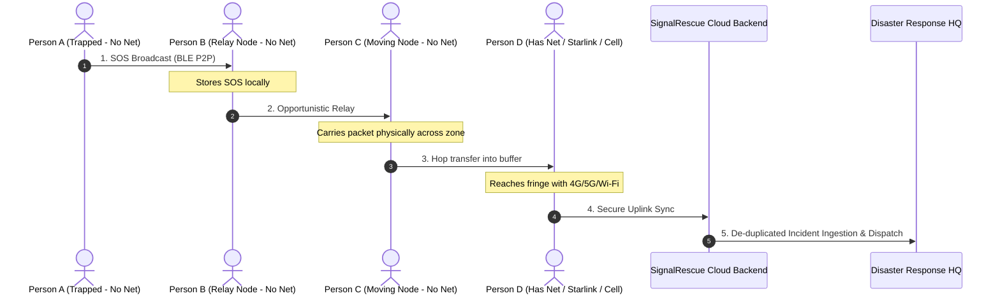
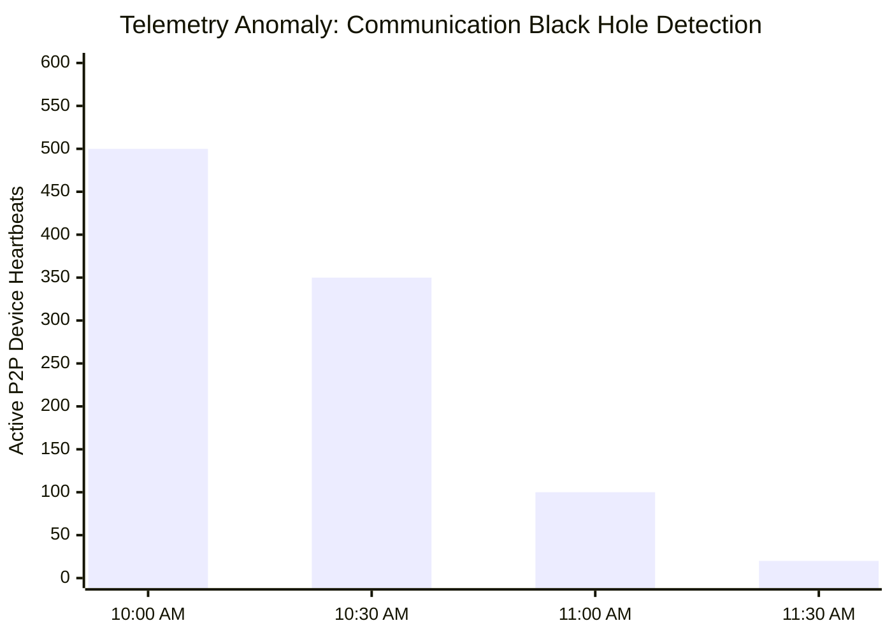
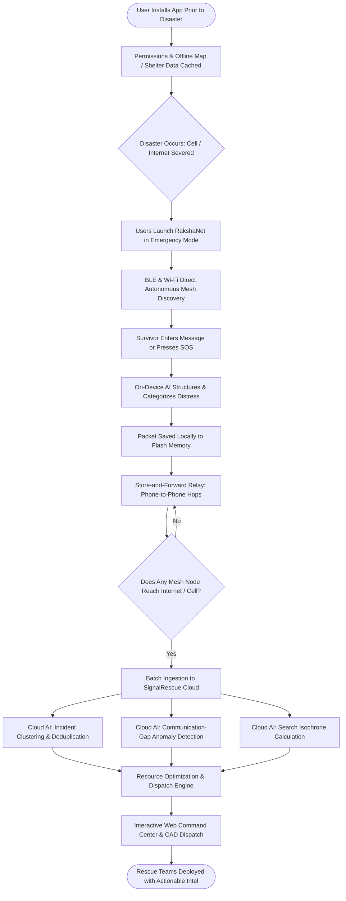

# RakshaNet — Offline Disaster Communication and AI Rescue System

> **One-Line Pitch:** An offline-first disaster communication and AI rescue system that turns nearby smartphones into a temporary emergency mesh and converts their collected SOS, location, and communication data into actionable intelligence for rescue agencies when Internet infrastructure is unavailable.

---

## Table of Contents

- [1. Idea Overview](#1-idea-overview)
- [2. Pre-Disaster Preparation & Onboarding](#2-pre-disaster-preparation--onboarding)
- [3. Offline Device-to-Device Communication](#3-offline-device-to-device-communication)
- [4. Multi-Hop Store-and-Forward Mesh](#4-multi-hop-store-and-forward-mesh)
- [5. Emergency SOS System](#5-emergency-sos-system)
- [6. Location Handling & Zero-GPS Fallbacks](#6-location-handling--zero-gps-fallbacks)
- [7. Offline Emergency Chat](#7-offline-emergency-chat)
- [8. Lightweight On-Device Offline AI](#8-lightweight-on-device-offline-ai)
- [9. Internet Recovery & Automatic Synchronization](#9-internet-recovery--automatic-synchronization)
- [10. Government & Rescue Agency Dispatch Integration](#10-government--rescue-agency-dispatch-integration)
- [11. SignalRescue AI Command Centre](#11-signalrescue-ai-command-centre)
- [12. AI Emergency Clustering](#12-ai-emergency-clustering)
- [13. Communication-Gap Detection](#13-communication-gap-detection)
- [14. Missing-Person Search Intelligence](#14-missing-person-search-intelligence)
- [15. Rescue Resource Optimization](#15-rescue-resource-optimization)
- [16. Economic & Operational Benefits](#16-economic--operational-benefits)
- [17. End-to-End System Workflow](#17-end-to-end-system-workflow)
- [18. Core Innovation](#18-core-innovation)
- [19. Hackathon Summary](#19-hackathon-summary)

---

## 1. Idea Overview

**SignalRescue AI (RakshaNet)** is a software-based disaster management system engineered for high-stakes scenarios where cellular networks, broadband Internet connections, and standard communication infrastructures fail. During extreme events—such as floods, earthquakes, cyclones, landslides, and urban fires—civilians frequently become isolated, injured, or trapped, cut off from loved ones, civil defense authorities, and emergency response teams.

RakshaNet turns nearby consumer smartphones running the application into an autonomous, temporary local ad-hoc communication network (mesh). Even in zero-connectivity environments, survivors can:
- Discover peer devices within radio range.
- Broadcast high-priority SOS distress beacons.
- Exchange peer-to-peer survival messages and updates.
- Relay their last known location and environment status.
- Forward distress data opportunistically across multiple device hops.

The platform unifies **offline wireless communication (BLE / Wi-Fi Direct)**, **local GPS / GNSS positioning**, **bundled offline cartography**, **compressed on-device SLMs (Small Language Models)**, **opportunistic store-and-forward delay-tolerant networking (DTN)**, and a **centralized Cloud AI Command Center** that ingests and orchestrates rescue operations whenever any participating node regains cellular or satellite connectivity.

---

## 2. Pre-Disaster Preparation & Onboarding

Resilience begins before the crisis occurs. Users download and initialize RakshaNet during standard civil preparedness campaigns or flood warnings.

### Initial Configuration & Permissions
Upon initial installation, the application guides users through setting up critical low-level hardware permissions:
- **Nearby Device Discovery & Communication:** Bluetooth Low Energy (BLE) scanning and advertising.
- **Wi-Fi Peer-to-Peer (Wi-Fi Direct / Local SoftAP):** High-bandwidth local transfers where supported.
- **Location & GNSS:** Hardware GPS, last known coordinates, and background updates.
- **Critical Notifications & Power Exemption:** Battery optimization overrides to ensure mesh background listener loops stay alive during emergencies.

### Bundled Offline Intelligence
The setup process bundles and caches crucial geographic and survival data directly onto device storage:
- High-compression vector map tiles for the local administrative zone / district.
- Geocoded registry of disaster shelters, relief camps, government hospitals, fire stations, and supply depots.
- Multilingual first-aid, flood evacuation, and triage survival runbooks.

This offline cache ensures that the application remains fully functional and informative the moment base transceiver stations (BTS) lose power or backhaul lines are severed.

---

## 3. Offline Device-to-Device Communication

The primary lifeline of the RakshaNet mobile client is zero-infrastructure peer-to-peer networking.

```text
┌───────────────────────┐                    ┌───────────────────────┐
│       Device A        │    BLE / Wi-Fi     │       Device B        │
│  (Survivor - Trapped) │  ◄──────────────►  │   (Nearby Citizen)    │
│  "Water rising, 5ppl" │    Direct Radio    │ "Received. Relaying!" │
└───────────────────────┘                    └───────────────────────┘
```

When cellular towers and ISPs collapse, RakshaNet instances activate local radio protocols:
- **Automatic Peer Discovery:** Devices broadcast short, cryptographically signed beacon packets over Bluetooth Low Energy (BLE) and Wi-Fi Direct channels.
- **Direct Exchange:** If Person A is trapped near a swollen river with five people, Person A types:
  > *"I am trapped near the bridge. There are five people with me."*
- **Direct Handshake:** The message transmits directly over-the-air to Person B's phone within 15–50 meters without requiring a cellular tower, Wi-Fi router, or cloud relay.
- **Local Persistence:** Every transmitted and received payload is stored in a local transactional database (e.g. SQLite / WatermelonDB) on both handsets, guaranteeing zero data loss if connection drops mid-session.

---

## 4. Multi-Hop Store-and-Forward Mesh

Because physical disaster zones span kilometers while consumer Bluetooth ranges span tens of meters, RakshaNet implements a **Store-and-Forward Delay-Tolerant Network (DTN)**.



### Store-and-Forward Lifecycle
1. **Origination:** Person A transmits an SOS. Person A has zero Internet.
2. **First Hop:** Person B receives and cryptographically validates the payload, storing it in an encrypted local outbox.
3. **Mule Transport:** As Person B or Person C moves toward safer ground, their device advertises the stored payloads to new peers.
4. **Fringe Ingestion:** Person D receives the packet chain and eventually enters an area with functioning cellular, satellite, or emergency Wi-Fi backhaul.
5. **Gateway Upload:** Person D's client automatically synchronizes its entire buffered backlog to the SignalRescue cloud backend.

Through this digital "bucket brigade," emergency dispatches navigate broken networks without requiring point-to-point end-to-end paths to exist simultaneously.

---

## 5. Emergency SOS System

The mobile interface is centered around an unmistakable, high-contrast, tactile SOS interface:

<div align="center">

### 🚨 **SEND SOS**
*(Press and hold for 1.5 seconds to prevent false triggers; double-tap accessible fallback)*

</div>

### Structured Payload Specification
When triggered, RakshaNet packages an immutable, compact JSON / Protocol Buffer packet:

| Field | Content / Description |
|---|---|
| `incident_id` | Globally unique UUID / Hash generated deterministically |
| `device_id` | Ephemeral hardware-pseudonym (e.g., `SR-8F31-A72C`) |
| `timestamp` | Exact UTC and local timestamp of emergency trigger |
| `coordinates` | Latitude, Longitude, and GNSS accuracy radius |
| `location_state` | `GPS_ACTIVE`, `LAST_KNOWN`, or `ESTIMATED_ZONE` |
| `people_count` | Number of impacted survivors (stepper input) |
| `emergency_type` | `FLOOD`, `TRAPPED`, `INJURED`, `FIRE`, `MEDICAL`, `EVACUATION` |
| `user_notes` | Free-text emergency notes or voice transcript |
| `battery_level` | Remaining battery percentage (critical for triage) |
| `relay_hops` | Array of hop signatures, RSSI values, and relay timestamps |

The SOS is written to flash memory first. Even if the phone is submerged or loses battery minutes later, every peer that passed within radio distance retains the distress payload.

---

## 6. Location Handling & Zero-GPS Fallbacks

Satellite GPS (GNSS) operates independently of cellular connectivity. However, inside collapsed structures, heavy rainstorms, or urban canyons, GPS satellite fixes may be completely obstructed. RakshaNet maintains transparent, verifiable location reporting:

```
┌────────────────────────────────────────────────────────┐
│  ⚠️ NO LIVE GPS SIGNAL                                 │
│  Last known fix: 250m west of current estimated area   │
│  Recorded at: 10:42 AM (24 mins ago)                   │
│  Uncertainty radius: ±120m                             │
└────────────────────────────────────────────────────────┘
```

- **No False Precision:** The system never fabricates coordinates or presents stale fixes as live positions.
- **Last Known Position Tracking:** When a fix drops, the app tags the coordinate with `LAST_KNOWN`, timestamp of last valid lock, and elapsed drift duration.
- **Multi-Lateral RSSI & Proximity Zones:** When multiple surrounding nodes encounter the trapped handset, their relative signal strengths (RSSI) form a convex hull. The cloud backend translates these observations into a **Probabilistic Search Zone** rather than an erroneous point coordinate.

---

## 7. Offline Emergency Chat

Beyond automated beacons, RakshaNet acts as an ad-hoc local conversational network:
- **Direct P2P & Neighborhood Broadcast:** Survivors within communication radius can converse, pool medical resources, coordinate flashlights, and alert neighbors about rising waters.
- **Pre-Configured Quick Triage Replies:** Instant tap responses formatted for extreme stress and low battery:
  - *"I am safe."*
  - *"Need potable water."*
  - *"Critical medical assistance required."*
  - *"Trapped under debris."*
- **Delivery Receipts & Relay Badges:** Clear visual indicators for every message:
  - 🕒 **Saved locally on this device**
  - 🔄 **Relayed across $N$ devices**
  - ✅ **Delivered to Central Rescue Command**

---

## 8. Lightweight On-Device Offline AI

RakshaNet embeds a quantized on-device Small Language Model / rule-triage engine (e.g., ONNX Runtime / ExecuTorch Mobile) capable of running completely offline on mid-tier consumer devices without cellular access.

### Core Capabilities
- **Unstructured Text Parsing:** Converts panicked colloquial text into structured triage records.
  - *Raw User Input:* *"Water is entering my house and my grandmother cannot walk."*
  - *Extracted Data:*
    - **Emergency Category:** Flood Inundation
    - **Affected Individuals:** 2+
    - **Specialized Vulnerabilities:** Elderly / Mobility Impaired
    - **Triage Urgency:** Critical / Priority 1
- **Multilingual Emergency Translation:** Translates vital survivor requests across regional languages (e.g., Hindi, Marathi, English) offline.
- **Offline Survival Guidance:** Provides dynamic instructions on electrical hazards, tourniquet application, and route guidance toward cached shelters based on local terrain data.

---

## 9. Internet Recovery & Automatic Synchronization

When any mesh node enters a zone with revived connectivity (e.g., field Wi-Fi, satellite mobile terminals, or peripheral cell towers):

1. **Background Socket Handshake:** The app detects network reachability and connects to the SignalRescue cloud ingest gateway.
2. **Idempotent Batch Uplink:** Buffered SOS signals, hop telemetry, device timestamps, and relayed chat logs are transmitted in compressed batches.
3. **Cryptographic Validation:** The cloud verifies packet signatures, eliminates relay duplicates, and returns cryptographic receipts.
4. **Reverse Acknowledgment:** The acknowledgment propagates back down through returning mesh nodes, flipping the survivor's status badge to *"Delivered to Rescue Command"*.

---

## 10. Government & Rescue Agency Dispatch Integration

Once ingested, the cloud backend automatically maps and transforms distress signals into standard emergency dispatch formats (CAP - Common Alerting Protocol, incident JSON APIs, and CAD dispatch tickets).

```json
{
  "incident_id": "SR-2026-1024",
  "category": "FLOOD_RESCUE",
  "urgency": "CRITICAL",
  "affected_population": 8,
  "vulnerabilities": ["ELDERLY", "MOBILITY_LIMITED"],
  "location": {
    "type": "ESTIMATED_ZONE",
    "polygon_geojson": { "type": "Polygon", "coordinates": [...] },
    "centroid": [19.0760, 72.8777],
    "accuracy_radius_meters": 180,
    "last_seen_time": "2026-10-02T11:42:00Z"
  },
  "relay_chain": {
    "total_hops": 4,
    "uplink_node_id": "SR-GATEWAY-49"
  },
  "recommended_response": ["INFLATABLE_BOAT_TEAM", "MEDICAL_PARAMEDIC"]
}
```

---

## 11. SignalRescue AI Command Centre

The web-based **Command Center** provides disaster response commanders with live situational awareness:

- **Incident Geo-Heatmap:** Real-time spatial clustering of verified SOS distress beacons.
- **Network Topology & Comm-Loss Zones:** Live map of active mesh nodes, relay density, and blacked-out sectors.
- **Search & Rescue Boundary Polygons:** Interactive overlays representing estimated survivor drift or flood inundation lines.
- **Resource Inventory Status:** Live telemetry tracking rescue vessels, ambulances, NDRF/SDRF teams, and available shelter capacities.

---

## 12. AI Emergency Clustering

Rather than bombarding dispatchers with thousands of isolated alerts from dense apartment complexes or urban blocks, the cloud AI aggregates reports:

```text
Individual Raw Pings:               AI Synthesis:
[10 SOS pings from Bldg A]   ──┐
[15 SOS pings from Bldg B]   ──┼──►  Cluster #12 (Sector 4B): 27 Survivors, High Flood, 
[ 2 SOS pings from Street C] ──┘     Inaccessible by Road -> Deploy 2x Rescue Boats
```

- **Deduplication:** Merges multiple family members broadcasting from the same dwelling.
- **Triage Synthesis:** Computes aggregate hazard scores, identifying structural collapses and medical crises immediately.

---

## 13. Communication-Gap Detection

One of RakshaNet's most distinctive innovations is detecting anomalies where signals unexpectedly disappear:



- **Temporal Trend Analysis:** If device heartbeats plummet in a sector without confirmed evacuations, the system flags a **Potential Communication Black Hole**.
- **Correlative Risk Assessment:** Cross-checks communication dropouts against river gauge sensors, landslide predictions, and electrical grid collapses to direct proactive reconnaissance drones and search teams.

---

## 14. Missing-Person Search Intelligence

When individual heartbeats cease, RakshaNet computes **Probabilistic Isochrone Search Zones**:
- Ingests last known coordinates, timestamp, terrain topography, road washouts, and flood flow vectors.
- Calculates an expanding probability envelope (e.g., *"Radius 150–300m, 68% confidence"*).
- Provides rescue teams with actionable bounding circles rather than blind grid searches.

---

## 15. Rescue Resource Optimization

A constrained rescue fleet requires optimal allocation. The RakshaNet optimization engine solves the dispatch assignment problem by evaluating:
- Incident severity and survivor count.
- Vehicle compatibility (boats vs. 4x4 trucks vs. air ambulances).
- Road route blockages and water depth contours.
- Distance and transit latency to triage trauma hospitals.

```
AI Dispatch Plan:
• NDRF Team 04 (Inflatable Boat) ──► Zone A (Water level 2.5m, 8 trapped)
• SDRF Paramedic 02 (High-clearance) ──► Zone B (Medical dialysis emergency)
• Civil Defense Team 09 ──────────► Zone C (Evacuation marshaling)
```

---

## 16. Economic & Operational Benefits

RakshaNet provides immense societal and economic value to emergency response agencies:
1. **Zero Capital Infrastructure Cost:** Leverages existing citizen smartphone hardware as ad-hoc nodes, bypassing multi-million dollar satellite-phone deployments during early disaster hours.
2. **Drastic Elimination of Redundant Searches:** Automated clustering prevents multiple search teams from responding independently to duplicate calls.
3. **Optimized Critical Asset Allocation:** Prevents fuel wastage, boat misallocation, and hospital intake bottlenecks.
4. **Rapid Restoration of Economic Infrastructure:** Granular communication-gap maps allow utility providers to pinpoint severed fiber-optic links and power sub-stations rapidly.

---

## 17. End-to-End System Workflow



---

## 18. Core Innovation

RakshaNet is not an ordinary offline messaging tool. Its uniqueness lies in uniting seven disconnected technical layers into one cohesive survival ecosystem:

$$\text{Offline P2P Mesh} + \text{Store-and-Forward DTN} + \text{On-Device SLM AI} + \text{Transparent Location Fallbacks} + \text{Comm-Gap Anomaly Detection} + \text{Cloud Incident Clustering} + \text{Automated Dispatch Optimization}$$

> ### **The Central Axiom:**
> *"Even when the Internet disappears, life-saving information must continue moving."*

---

## 19. Hackathon Summary

| Aspect | Detail |
|---|---|
| **Project Name** | **RakshaNet (SignalRescue AI)** |
| **Domain** | Disaster Management / Mesh Networking / Edge & Cloud AI |
| **Target Users** | Disaster survivors, rescue agencies (NDRF/SDRF), emergency coordinators |
| **Frontend Mobile** | React Native (Android-first), BLE & Wi-Fi Direct Mesh, SQLite, On-Device AI |
| **Dashboard** | React Command Center, MapLibre GL, Real-time WebSocket / GeoJSON feeds |
| **Backend & AI** | Fast cloud ingestion gateway, spatial clustering (DBSCAN / HDBSCAN), DTN relay parser |
| **Key Differentiator** | Turns everyday consumer phones into a resilient multi-hop communication mesh when all cellular infrastructure fails |
